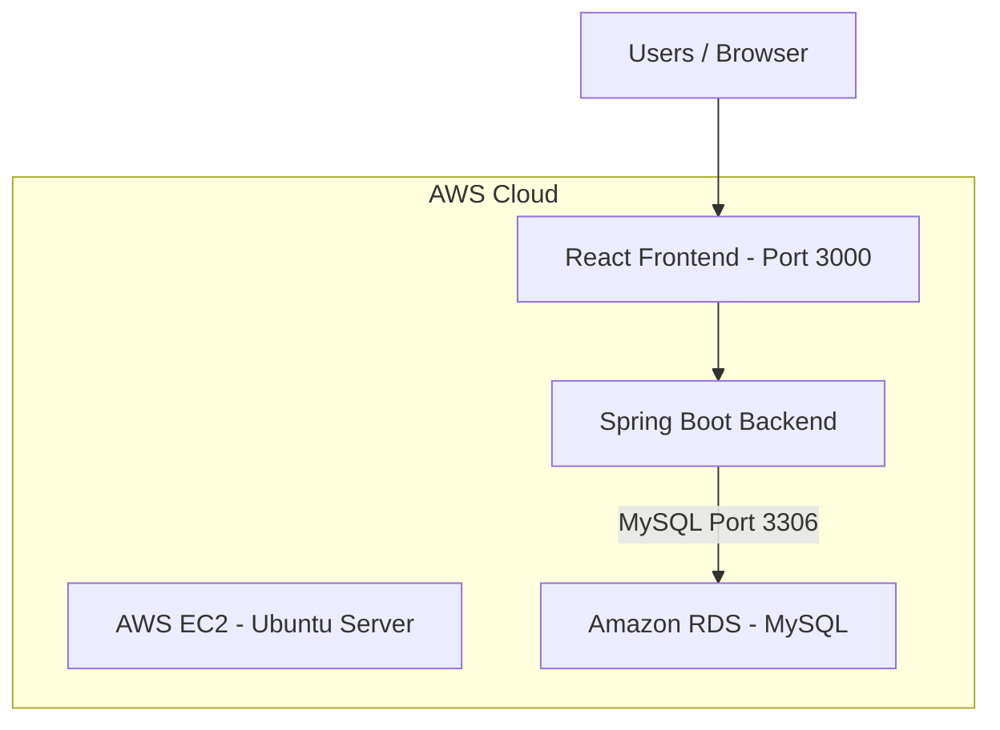

# Floodify – AWS Architecture

## Deployment Architecture

## Architecture Explanation

- **Users:** Access the Floodify application through a web browser.
- **Amazon EC2:** Hosts the React frontend and Spring Boot backend on Ubuntu.
- **React Frontend:** Runs on port 3000.
- **Spring Boot Backend:** Handles application API requests.
- **Amazon RDS:** Hosts the MySQL database.
- **Security Groups:** Allow the EC2 instance to communicate with RDS over port 3306.

## Deployment Flow

1. Create the AWS VPC.
2. Configure Amazon RDS MySQL.
3. Launch the Ubuntu EC2 instance.
4. Configure EC2 and RDS security groups.
5. Install application dependencies.
6. Clone the Floodify repository.
7. Configure the backend database connection.
8. Build and run the Spring Boot backend.
9. Start the React frontend.
10. Verify application connectivity.
